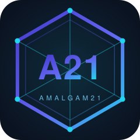

<p align="center">
  
</p>

<h1 align="center">Amalgam21 Token (A21)</h1>

<p align="center"><b>A proprietary post-quantum digital token.</b></p>

<p align="center">
  <a href="https://github.com/arabafenice599rae/Amalgam21-A21/actions/workflows/ci.yml"></a>
  <a href="https://github.com/arabafenice599rae/Amalgam21-A21/actions/workflows/tests.yml"></a>
  <a href="https://github.com/arabafenice599rae/Amalgam21-A21/actions/workflows/security.yml"></a>
  <a href="https://github.com/arabafenice599rae/Amalgam21-A21/actions/workflows/benchmarks.yml"></a>
  
  
</p>

---

## Overview

Amalgam21 (A21) is a post-quantum digital ledger with an authoritative, single-signer consensus model. Every value transfer is authorized by a lattice-based signature that remains secure against quantum attackers, and the full engineering pipeline is enforced automatically by GitHub Actions.

## Cryptographic Stack

| Layer | Algorithm | Notes |
|-------|-----------|-------|
| Signatures | ML-DSA-65 (FIPS 204) | NIST security level 3, via formally verified libcrux |
| Hashing | SHAKE256 (512-bit output) | Domain-separated via SHA-3 |
| Key derivation | Argon2id | PHC winner, memory-hard |
| Wallet encryption | XChaCha20-Poly1305 AEAD | Authenticated encryption |
| Secret hygiene | `zeroize` | Secrets are wiped from memory |

## Workspace Structure

| Crate | Purpose |
|-------|---------|
| `core/` (`token-postquantum`) | The token core: binary formats, wallet, accounts, blocks, anchor, journal, and an ERC-20-like facade, plus an end-to-end interactive demo |
| `export/` (`token-postquantum-export`) | Derived, non-authoritative views for explorers and indexers: JSON balance snapshots and a JSONL block index |
| `stress/` | Episode-based load harness for sustained transaction throughput |
| `fuzz/` | libFuzzer targets for deserialization paths (nightly, standalone workspace) |

## Quality Assurance

Ten complementary tools guard the codebase, each mapped to a CI workflow:

| Tool | Role | Workflow |
|------|------|----------|
| `cargo test` | 21 unit + 14 integration tests | CI (every push) |
| cargo-nextest | Parallel, fault-tolerant test runner | Tests (intensive) |
| proptest | Property-based exploration of transaction invariants | Tests (intensive) |
| cargo-mutants | Surviving-mutant detection | Security |
| Miri | Undefined behavior detection on the export crate | Security |
| cargo-audit | RUSTSEC advisories in dependencies | CI + Security |
| cargo-deny | License and dependency policy | Security |
| cargo-geiger | Unsafe-code census | Security |
| Criterion | Statistical wall-clock benchmarks | Benchmarks (weekly) |
| iai-callgrind | Deterministic instruction-count benchmarks via Valgrind | Benchmarks (weekly) |

Additional schedules: fuzzing runs weekly on Saturdays; the stress harness runs nightly with escalating load levels, up to 1M-transaction dispatches.

## Security Model

- **Same-block claim verification**: a `Transfer` whose sender is first registered by a `Claim` in the same block is verified against the newly registered verifying key before any state mutation; forged transfers are rejected (regression-tested).
- **Integer-only arithmetic**: amounts are `u64` units; floating point is never used for balances.
- **Non-custodial wallet**: the passphrase never leaves the client; keys are sealed under Argon2id-derived AEAD keys.

## Getting Started

### Prerequisites

- Rust (stable toolchain)
- Valgrind (only for iai-callgrind benchmarks)

### Build

```bash
cargo build --workspace
```

### Test

```bash
cargo test --workspace
```

### Run the Demo

```bash
cargo run -p token-postquantum   # interactive demo (passphrase via prompt)
```

### Benchmarks

```bash
cargo bench -p token-postquantum --bench ledger --bench signatures --bench persistence   # Criterion
cargo bench -p token-postquantum --bench iai_signatures --bench iai_persistence          # iai-callgrind (needs Valgrind)
```

## Token Model

| Property | Value |
|----------|-------|
| Total supply | 100,000,000 A21 |
| Decimals | 6 |
| Amount representation | Integer `u64` units — floating point is never used |
| Fees | Fixed integer fee to the system account |
| Cashback | 90% of fees, paid from a dedicated pool |
| Binary formats | Unchanged since v0.8 |

Security declarations and known limitations are documented in the source file headers.

## License

Copyright Amalgam21. All rights reserved. No license of use is granted.
